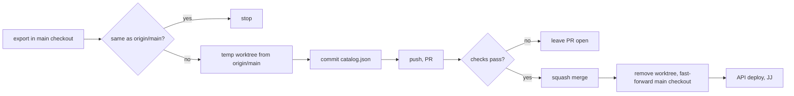

# 0006: publish.sh lands catalog snapshots through a PR

**Status:** accepted, 2026-11-08 (JJ; the temporary-worktree approach was decided during the build).

## context

`scripts/publish.sh` re-exports `src/data/catalog.json` from the crawl database, then committed it in the checkout it ran from and pushed to `main`. `main` now has the "Protect main" ruleset (`0008-protect-main.md`), which refuses direct pushes. The script runs from the live main checkout (`../../AGENTS.md`), where the crawl jobs run and the database lives, so it must never switch that checkout's branch or lose anything in it. `scripts/run_jobs.sh` does not call it; JJ runs it by hand.

## decision

`publish.sh` now:

1. exports into the checkout it runs from, as before, and stops if the snapshot matches `origin/main`;
2. creates a temporary worktree from `origin/main` on a new branch `publish/catalog-<timestamp>`, copies in the snapshot and commits only `src/data/catalog.json`;
3. pushes with `git push -u origin HEAD`, opens a PR with `gh pr create`, waits for every check (`gh pr checks --watch`; no checks yet is fine), and merges with `gh pr merge --squash`;
4. removes the worktree and local branch, then fast-forwards the main checkout (staging the exported snapshot first only when it matches what was merged, which is what lets the fast-forward through);
5. rebuilds and deploys the API as before. That step is JJ's.

If checks fail, the PR stays open and the script stops. It never resets, cleans, stashes or force-pushes. `--dry-run` does steps 1–2, prints the rest, and removes the worktree and branch; `--no-export` publishes the snapshot already on disk.

## why

- A worktree means the live checkout never leaves `main`, so the jobs and the gitignored data are never disturbed.
- Waiting for checks keeps a broken snapshot off production once CI exists.

## alternatives

- **Branch and commit in the main checkout.** Switches the branch under the running jobs. Rejected.
- **`gh pr merge --auto`.** Needs auto-merge turned on in the repo and required checks; the explicit wait works either way.
- **A bypass for the script.** Defeats the ruleset. Rejected.

## revisit when

- Publishing moves off JJ's machine (a scheduled job): run the same steps in CI instead.
